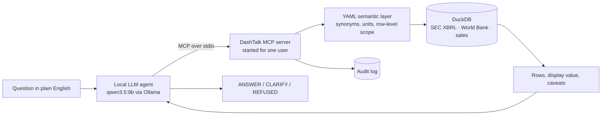
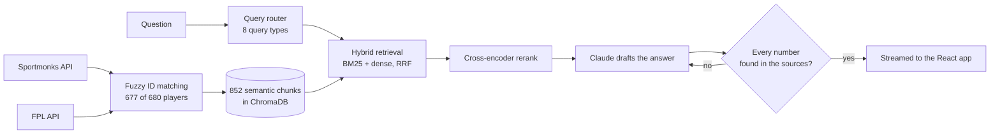
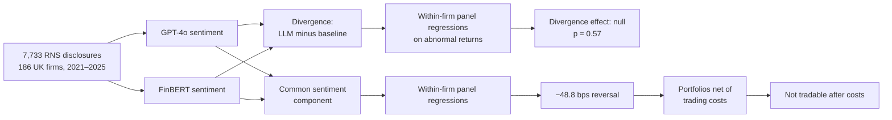

**Graduate Data & AI Engineer in London.** MSc Financial Technology, Warwick Business School (Distinction).

I build data pipelines that are tested and monitored, and LLM systems that are checked before anyone trusts them, mostly on finance data. Open to graduate data and AI engineering roles in the UK.

  
  

<b>DutyLens</b> asks whether an LLM can spot vulnerable customers in complaints better than a cheap model, and at what cost. Label 3 real complaints in about 2 minutes; your answers stay in your browser.

### Featured work

| Project | What it does | Result |
|---|---|---|
| [**DashTalk**](https://github.com/ShivaanjanB/dashtalk) | Ask dashboards questions in plain English. A YAML semantic layer defines every metric once, and an MCP server enforces row-level permissions. | **0 permission leaks and 0 wrong figures** across two eval runs; caught 2 SEC data faults by checking answers against filings |
| [**FantasyCoach AI**](https://github.com/ShivaanjanB/Fantasy_AI) | Hybrid RAG over live football APIs: BM25 + dense retrieval, reranking and a verifier for every numeric claim. | Factual accuracy **62% → 89%**, hallucinations **38% → 11%** on a 30-query adversarial benchmark |
| [**LLM disclosure sentiment**](https://github.com/ShivaanjanB/dissertation-pilot) | MSc dissertation: GPT-4o vs FinBERT on 7,733 UK company disclosures from 186 firms. | An honest null: the main effect is not significant (p = 0.57), and the one reversal found does not survive trading costs |

<b>How DashTalk works</b>

Permissions are enforced in the server, not the prompt, so a model that is talked into asking still cannot fetch a hidden figure.

<b>How FantasyCoach AI works</b>

<b>How the dissertation test works</b>

### At a glance

  
  

Infographics refreshed daily with <a href="https://github.com/lowlighter/metrics">lowlighter/metrics</a>.

### Toolkit

          

### Elsewhere

[Portfolio](https://shivaanjan.co.uk) · [LinkedIn](https://www.linkedin.com/in/shivaanjan-bhattacharjee) · rishhbhatt06@gmail.com
